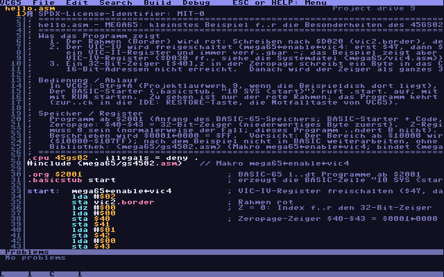

# VC65

**Programmieren auf dem MEGA65, direkt auf dem MEGA65.** VC65 ist eine Entwicklungsumgebung, die auf dem Rechner selbst läuft, ohne PC: ein Vollbild-Editor, ein Assembler, Bauen und Starten mit einem Tastendruck und ein Debugger zum Schrittweise-Ausführen. Projekte liegen auf der SD-Karte.

> **Vorabversion (Alpha).** VC65 wurde bisher **nur im Emulator Xemu** getestet, am echten MEGA65 noch nicht. Rückmeldungen vom echten Gerät sind willkommen.

## Was VC65 kann
- **Editor** (80 × 50 Zeichen): Farbhervorhebung, Zeilennummern, Auswahl, Kopieren und Einfügen, Rückgängig, Suchen und Ersetzen, Gehe zu Zeile, Marken, Ausrichten in Spalten, Hex-Rechner. Ein Menü erreichen Sie mit der HELP-Taste oder ESC.
- **Assembler** für den 45GS02 des MEGA65 in der Sprache VCASM. Fehler erscheinen mit Code, Zeile und Spalte, fehlerhafte Zeilen sind rot markiert, und der Text wird bei jedem Zeilenwechsel im Hintergrund geprüft.
- **Bauen und Starten:** übersetzen (Strg+E), Programm speichern (Strg+F), starten (Strg+R) und zurück in den Editor.
- **Debugger:** Haltepunkte, Einzelschritt, Register, Speicher, Disassemblierung und eine Notfalltaste (RESTORE) für hängende Programme.
- **Beispiele:** `hello`, `pal_demo`, `music_demo` und `prallball`, fertig als Quelltext zum Ausprobieren.

## Schnellstart
1. Laden Sie unter [Releases](https://github.com/CDrueeke/VC65/releases) die Boot-Diskette `VC65-<Version>.d81` herunter (und, wenn Sie möchten, die Beispiel-Diskette). Die Prüfsummen stehen in `SHA256SUMS`.
2. Binden Sie die Boot-Diskette als Laufwerk 8 ein, am MEGA65 über die SD-Karte oder im Emulator Xemu. Das ROM des MEGA65 gehört Dritten und gehört nicht zum Paket.
3. Starten Sie in BASIC 65 mit `DLOAD "VC65"` und `RUN`.
4. Die Beispiel-Diskette kommt in Laufwerk 9. Schalten Sie in VC65 mit Strg+A auf Laufwerk 9, laden Sie mit Strg+O ein Beispiel (zum Beispiel `hello`), übersetzen Sie es mit Strg+E und starten Sie es mit Strg+R.

Das Programm VC65 selbst ist englisch; Handbuch und Webseite gibt es auf Deutsch und Englisch.

## Dokumentation
- **Handbuch** mit Anleitung „Ihr erstes Programm“, Tastenübersicht, Fehlercodes und Fehlersuche: [Deutsch](docs/benutzer/de/README.md) · [English](docs/benutzer/en/README.md). Als PDF finden Sie es bei jedem Release.
- **Release-Hinweise:** [`docs/release/0.1.1-alpha.md`](docs/release/0.1.1-alpha.md) · **Änderungen:** [`CHANGELOG.md`](CHANGELOG.md)
- **Entwicklerdokumentation** (Aufbau der IDE, Editor, Assembler, Debugger, Tests): [`docs/entwickler/`](docs/entwickler/)

## VintageCoder
VC65 ist ein Schwesterprojekt von **[VintageCoder](https://github.com/CDrueeke/VintageCoder)**, der Entwicklungsumgebung für 8-Bit-Systeme auf dem PC ([Webseite](https://vintagecoder.drueeke.de/)). Beide sprechen dieselbe Assemblersprache **VCASM**, ein Programm lässt sich also in beiden entwickeln. VC65 ist die Fassung, die auf dem MEGA65 selbst läuft.

## English
**VC65** is a native development environment that runs on the MEGA65 itself, no PC needed: full-screen editor, assembler, build and run, and a debugger. It is a **pre-release (alpha), tested in the Xemu emulator only**; nothing is verified on a real MEGA65 yet. Download the boot disk from [Releases](https://github.com/CDrueeke/VC65/releases), mount it as drive 8 and start it with `DLOAD "VC65"` and `RUN` in BASIC 65. Manual: [docs/benutzer/en](docs/benutzer/en/README.md). VC65 is a sister project of [VintageCoder](https://github.com/CDrueeke/VintageCoder) and uses the same assembly language, VCASM.

## Mitarbeit
Hinweise und Fehlermeldungen sind willkommen, siehe [CONTRIBUTING.md](CONTRIBUTING.md) und [CODE_OF_CONDUCT.md](CODE_OF_CONDUCT.md). Sicherheitsmeldungen: [SECURITY.md](SECURITY.md).

## Lizenz
VC65 steht unter der **GNU General Public License, Version 3 oder später** ([LICENSE](LICENSE)). Was Sie mit VC65 erzeugen, die Sprache VCASM und die Dateiformate sind frei nutzbar ([LICENSING.md](LICENSING.md)). Systemdateien, Vorlagen und Beispiele stehen unter MIT-0 ([LICENSES/MIT-0.txt](LICENSES/MIT-0.txt)). Die Software wird ohne jede Gewährleistung bereitgestellt. Fremdanteile: [THIRD-PARTY-NOTICES.md](THIRD-PARTY-NOTICES.md). Das Logo steht unter den Bedingungen in `LICENSING.md`.
