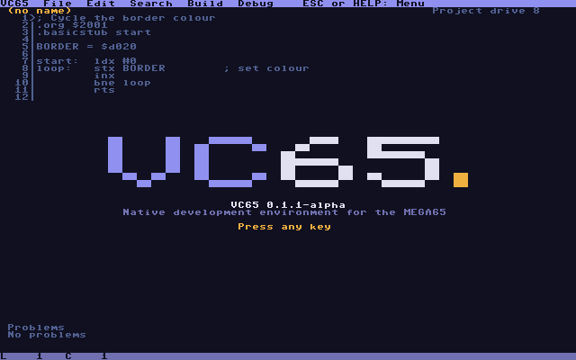

<!-- SPDX-License-Identifier: MIT-0 -->
# 1 Einstieg

Englische Fassung: [../en/01-getting-started.md](../en/01-getting-started.md). Zurück zur [Übersicht](README.md).

Dieses Handbuch beschreibt die **Vorabversion 0.1.1-Alpha** von VC65. Vieles ist bisher nur im Emulator Xemu getestet; der Abschnitt [Stand und Grenzen](#stand-und-grenzen) nennt, was am echten Gerät noch nicht geprüft ist.

## Was ist VC65

VC65 ist eine Entwicklungsumgebung, die **auf dem MEGA65 selbst** läuft. Sie vereint in einem Programm:

- einen Vollbild-**Editor** (80 × 50 Zeichen),
- einen **Assembler**, der die Sprache VCASM von VintageCoder versteht,
- einen **Debugger** (Haltepunkte, Einzelschritt, Register).

Quelltext schreiben, übersetzen, starten und prüfen geschieht auf dem Gerät, ohne PC. VC65 arbeitet nur mit dem **MEGA65** als Ziel. Ein C64-Ziel gibt es nicht.

Der Editor arbeitet mit **einer** Datei; Reiter für mehrere Dateien gibt es nicht.

## Sprache des Programms: nur Englisch

Die Oberfläche von VC65 (Befehlsleiste, Menüs, Meldungen der Statuszeile, Eingabezeilen, Probleme-Leiste) und der Debugger sind **nur englisch**. Das Handbuch und die Webseite gibt es auf **Deutsch und Englisch**. In diesem Handbuch steht der Text des Programms in Code-Schreibweise, zum Beispiel `Assemble first`, bei Bedarf mit kurzer deutscher Erklärung in Klammern. Die Fehlercodes `E2nn`/`W2nn` und `E9xx` sind unverändert.

## Voraussetzungen

- Ein MEGA65 mit dem Original-ROM (Xemu zum Testen ohne Gerät).
- Das Laufwerk 8 mit der Boot-Diskette (D81, siehe unten).
- Für eigene Quelltexte ein Projektlaufwerk: Laufwerk 8 oder 9 (siehe [Zwei Laufwerke](#zwei-laufwerke)).

## Dateien auf der Boot-D81

Die Diskette mit VC65 (die Systemdisk) enthält:

| Datei | Inhalt |
|---|---|
| `VC65` | das Hauptprogramm (Editor und Assembler) |
| `VC65D` | der Debugger; wird beim ersten Start des Debuggers (Strg+D) geladen |
| `VC65T` | die Befehlstabelle des Assemblers; wird beim Start geladen |
| `VC65X` | Werkzeug-Overlay (Ausrichten usw.); wird beim ersten Gebrauch geladen und ersetzt dabei das Debugger-Overlay (das beim nächsten Strg+D neu geladen wird) |
| Systembibliotheken | die Systemdateien des MEGA65 als Dateien mit flachen Namen `ORD.NAME` |

Fehlt `VC65T`, kehrt VC65 beim Start zu BASIC zurück. Fehlt `VC65X`, meldet die IDE `File VC65X missing`, wenn ein Werkzeug gebraucht wird. Fehlt `VC65D`, meldet die IDE beim Debuggerstart `File VC65D missing`.

### Namen der Systembibliotheken

Ein D81 kennt keine Ordner und Namen mit höchstens 16 Zeichen. Eine Bibliothek `<ordner/name.endung>` heißt deshalb `ORD.NAME`: die ersten drei Zeichen des Ordners, ein Punkt, der Name ohne Endung, alles in Großbuchstaben.

| Im Quelltext | Name auf der Diskette |
|---|---|
| `<mega65/vic4.asm>` | `MEG.VIC4` |
| `<common/tiles.asm>` | `COM.TILES` |
| `<c64/hardware.asm>` | `C64.HARDWARE` |

Die Datei `MEG.CHIPS` enthält die Chip-Symbole (zum Beispiel `vic2.border`); der Assembler bindet sie bei jedem Übersetzen selbst ein. Fehlt sie, fehlen nur diese Symbole. Die Systemdisk umfasst derzeit 14 Bibliotheksdateien (rund 150 KB).

## Start

VC65 ist ein PRG, das BASIC lädt und das mit `RUN` gestartet wird. Beim Start kopiert es sich in einen eigenen Speicherbereich (Bank 4); danach ist der Hauptspeicher (Bank 0) für das Testprogramm frei. Nach dem Start zeigt ein Startbild das Logo und die Version; eine beliebige Taste führt in den Editor. Dasselbe Bild erscheint unter **File > About VC65**. Mit **STOP** beenden Sie VC65 und kehren zu BASIC zurück.

## Zwei Laufwerke

| Laufwerk | Aufgabe |
|---|---|
| **Systemdisk**, Laufwerk 8 | VC65 selbst, das Overlay `VC65D`, die Systembibliotheken |
| **Projektlaufwerk**, 8 oder 9 | Ihr Quelltext: Laden, Speichern, eigene `.include`-Dateien |

Das Projektlaufwerk ist anfangs 8. **Strg+A** schaltet zwischen 8 und 9 um (Meldung `Project drive 9`). Das aktuelle Projektlaufwerk steht rechts in der Dateizeile. Der Quelltext liegt normalerweise auf einer zweiten D81 in Laufwerk 9.

## Stand und Grenzen

**Vorabversion 0.1.1-Alpha.** Alles in VC65 läuft im Emulator **Xemu** und besteht dort die Tests. Am **echten MEGA65 ist nichts davon vollständig geprüft**. Das Handbuch kennzeichnet die Punkte, die besonders offen sind, mit dem Hinweis „nur im Emulator Xemu getestet, am echten Gerät ungeprüft“:

- die **HELP-Taste** (Tastencode `$84`) und damit das **Menü** mit allen Menüpunkten, ebenso die **ESC-Taste** und die Funktionstasten (VC65 schaltet die Funktionstasten-Belegung des KERNAL beim Start ab),
- das **50-Zeilen-Bild** mit Kopfzeilen, Probleme-Leiste und Farben,
- das **Laden der Datei `VC65T`** beim Start,
- die **automatische Prüfung** bei Zeilenwechsel (Geschwindigkeit),
- **zwei D81** (Systemdisk und Projektlaufwerk) und das Umschalten mit Strg+A,
- die **Notfalltaste RESTORE**,
- die Tasten des Debuggers und die Wege über `BRK` und KERNAL,
- die Tastencodes der übrigen Tasten (alle Tastenbelegungen sind vorläufig).

Weitere Grenzen:

- Es gibt nur ein Ziel, `mega65`. Andere Ziele meldet der Assembler als Fehler E207.
- Keine Reiter, ein Quelltext zur Zeit.
- Der Assembler versteht VCASM nicht vollständig; siehe [Kapitel 3](03-assembler.md).
- Der Debugger hat Grenzen; siehe [Kapitel 5](05-debugger.md).
- Die Tastenbelegung ist vorläufig und kann sich noch ändern.

## Lizenz

Was Sie mit VC65 erzeugen, gehört Ihnen und darf frei verwendet werden. VC65 selbst steht unter GPL-3.0-or-later. Einzelheiten: [LICENSING.md](../../../LICENSING.md) (deutsch).
