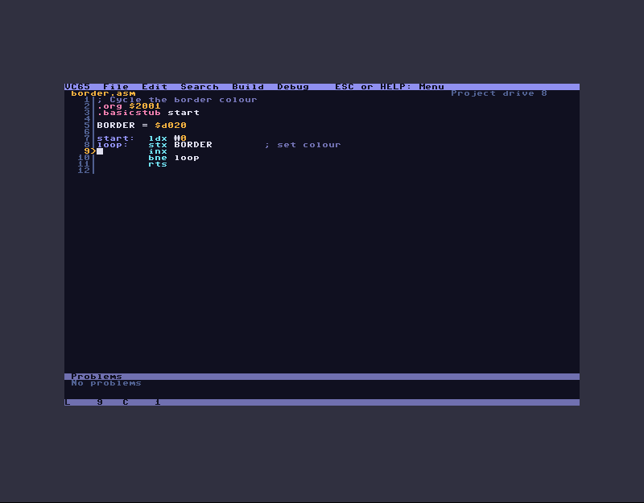
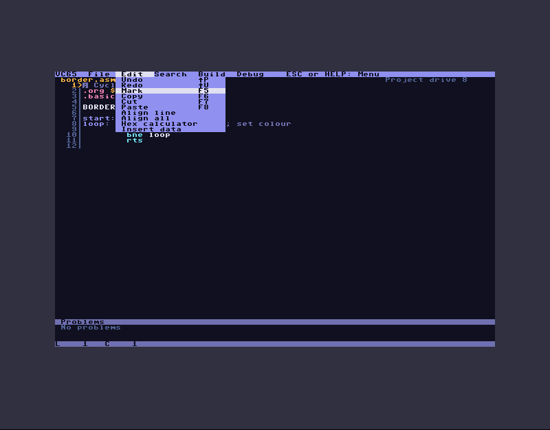

<!-- SPDX-License-Identifier: MIT-0 -->
# 2 Editor

Englische Fassung: [../en/02-editor.md](../en/02-editor.md). Zurück zur [Übersicht](README.md). Vorabversion 0.1.0-Alpha.

> **Hinweis:** Alle Tastencodes sind vorläufig. Der Editor ist nur im Emulator Xemu getestet, am echten Gerät ungeprüft. Das gilt besonders für die HELP-Taste (Code `$84`), das Menü und das 50-Zeilen-Bild.

## Bildschirm

Der Editor zeigt 80 × 50 Zeichen. Von oben nach unten:

| Zeile | Inhalt |
|---|---|
| 0 | **Befehlsleiste** (hellblau): `VC65  File  Edit  Search  Build  Debug` und rechts `ESC or HELP: Menu` |
| 1 | **Dateizeile**: Name der Datei (oder `(no name)`) und rechts das Projektlaufwerk |
| 2 bis … | **Text** mit fünf Spalten Zeilennummern und einem senkrechten Strich dahinter |
| 4 Zeilen | **Probleme-Leiste**: Kopf `Problems` und bis zu drei Einträge des letzten Übersetzens |
| letzte | **Statuszeile**: Meldungen und Eingabezeilen; rechts die Cursorposition `L nnnn C nnnn` (L = Zeile, C = Spalte) |

Die Cursorzeile trägt ein `>` und eine gelbe Zeilennummer. Eine Auswahl wird umgekehrt dargestellt. Der Text wird beim Eintippen eingefärbt: Kommentare, Text, Zahlen, Direktiven, Marken (Labels) und Befehle haben je eine eigene Farbe.

Zeilen mit Fehlern werden **rot** gefärbt (höchstens 16 Zeilen). In der Probleme-Leiste stehen Fehler rot (zum Beispiel `E205 line 10 col 13`) und Warnungen gelb (`W206 …`); ohne Einträge steht dort `No problems`. Mehr dazu in [Kapitel 4](04-bauen-und-starten.md).

Der Editor arbeitet mit **einer** Datei, höchstens 768 KB Text. Zeilenende ist intern LF; das Zeichen mit Code 0 kommt im Text nicht vor.

## Tasten

Die Tabelle zeigt die Tasten des Editors. Befehle zu Bauen, Starten und Debugger stehen in [Kapitel 4](04-bauen-und-starten.md) und [5](05-debugger.md); eine Gesamtliste steht in der [Referenz](07-referenz.md).

| Taste | Wirkung |
|---|---|
| Zeichentasten | Zeichen einfügen |
| Return | neue Zeile, mit Einrückung der Vorzeile |
| Tab | bis zum nächsten Vielfachen von 4 |
| DEL | Zeichen links löschen |
| Umschalt+DEL (`$94`) | Zeichen unter dem Cursor löschen (Entfernen vorwärts) |
| Cursortasten | bewegen |
| Pos1 (HOME) | Zeilenanfang |
| CLR (`$93`) | Zeilenende |
| Strg+V (`$16`) / Strg+W (`$17`) | Seite zurück / vor |
| Strg+P (`$10`) | Rückgängig |
| Strg+U (`$15`) | Wiederholen |
| F1 | Suchen |
| F2 | weitersuchen |
| F4 | rückwärts suchen |
| F3 | Gehe zu Zeile |
| F5 | Markieren (Auswahl beginnen oder aufheben) |
| F6 | Kopieren |
| F7 | Ausschneiden |
| F8 | Einfügen |
| Strg+O (`$0F`) | Datei laden |
| Strg+K (`$0B`) | Datei speichern |
| Strg+A (`$01`) | Projektlaufwerk 8 / 9 |
| ESC / HELP (`$84`) | Menü öffnen (ESC schließt es auch) |
| STOP | VC65 beenden |

## Auswahl, Kopieren, Rückgängig

**Auswahl:** F5 setzt den Anfang an den Cursor. Danach ziehen die Bewegungstasten die Auswahl auf. Ein weiteres F5 hebt sie auf.

**Zwischenablage:** F6 kopiert (und hebt die Auswahl auf), F7 schneidet aus, F8 fügt ein; eine aktive Auswahl wird beim Einfügen ersetzt. Die Zwischenablage fasst höchstens 64 KB. Ist die Auswahl zu groß oder der Speicher voll, passiert nichts. Sie bleibt beim Laden einer anderen Datei erhalten, so lässt sich Text zwischen Dateien übertragen.

**Löschen:** DEL und Umschalt+DEL löschen eine aktive Auswahl. Zeichen, Return, Tab, Rückgängig und Wiederholen heben die Auswahl auf.

**Rückgängig und Wiederholen:** Aufeinanderfolgende Eingaben gleicher Art (Zeichen und Tab, Return, DEL, Umschalt+DEL) bilden eine Gruppe. Rückgängig macht jeweils die ganze letzte Gruppe zurück, Wiederholen spielt sie wieder vor. Ausschneiden, Einfügen und das Löschen einer Auswahl sind je eine Gruppe. Eine neue Änderung verwirft die Wiederholungsstufen. Beim Laden einer Datei wird der Verlauf geleert.

## Suchen, Ersetzen, Gehe zu

**Suchen (F1):** In der Statuszeile erscheint `Find:  …` mit dem letzten Muster zum Bearbeiten (höchstens 32 Zeichen). Return übernimmt, STOP bricht ab. Gesucht wird ab dem Cursor und umbrechend über das Textende; Groß- und Kleinschreibung zählt nicht. Bei einem Treffer steht der Cursor darauf; sonst bleibt er, wo er war. **F2** sucht weiter, **F4** rückwärts.

**Ersetzen (Menü Search > Replace):** Zwei Eingabezeilen, `Find:` und `Replace`. Ersetzt werden **alle Treffer ab dem Cursor bis zum Textende** (ohne Umbruch, Groß- und Kleinschreibung egal). Die Meldung lautet `n replaced`. Jeder Ersatz lässt sich Schritt für Schritt mit Rückgängig zurücknehmen.

**Gehe zu (F3):** Eingabezeile `Line:  …`, höchstens 4 Ziffern. 0 gilt als 1; hinter der letzten Zeile landet der Cursor am Anfang der letzten Zeile.

**Marken 1 bis 9 (Menü Search):** *Set mark* fragt eine Ziffer 1 bis 9 ab und merkt sich die Nummer der Cursorzeile (Eingabezeile `Mark:  `, Meldung `Mark set`). *Go to mark* fragt eine Ziffer ab und springt zu dieser Zeile; ist die Marke nicht gesetzt: `Mark not set`. Eine Marke ist eine **Zeilennummer**; sie wandert nicht mit, wenn davor Zeilen eingefügt oder gelöscht werden.

**Find label (Menü Search):** fragt (Eingabezeile `Label: `) einen Namen ab und springt zur Zeile, die mit diesem Namen beginnt und danach Doppelpunkt, Leerraum oder Zeilenende hat. Groß- und Kleinschreibung zählt nicht. Findet sich nichts: `Label not found`. Die Suche überschreibt das Suchmuster von F1.

## Hex-Rechner und Daten einfügen

Beide liegen im Menü Edit und nutzen eine Eingabezeile (Return übernimmt, STOP bricht ab); sie werden beim ersten Gebrauch aus der Datei `VC65X` geladen.

- **Hex calculator (Hex-Rechner):** Eingabezeile `Calc:  `, Eingabe wie `2000+3f` oder `$d020-$d000` (16 Bit, hexadezimal, `$` darf fehlen). Die Statuszeile zeigt `$203f = 8255` (hexadezimal und dezimal). Bei einer ungültigen Eingabe erscheint `Input?`.
- **Insert data (Daten einfügen):** Eingabezeile `Range: `, Eingabe `von bis` in Hexadezimal, zum Beispiel `2000 20ff`. Der Speicherbereich des Testprogramms (Bank 0) wird als Zeilen `        .byte $xx,$xx,…` (8 Werte je Zeile) **vor** der Cursorzeile eingefügt; höchstens 256 Byte, sonst `Range too large (256)`.

## Ausrichten

Menü Edit > *Align line* (aktuelle Zeile) oder *Align all* (ganzer Text) setzt Marken, Befehle, Operanden und Kommentare in feste Spalten:

| Teil | Spalte |
|---|---|
| Marke | 0 |
| Befehl | 8 |
| Operand | 8 + größerer Wert von 4 und (Länge des Befehls + 1) |
| Kommentar | 32, oder ein Leerzeichen hinter dem Operanden, wenn der Platz fehlt |

Unverändert bleiben Kommentarzeilen, Zeilen mit `.` oder `#` in Spalte 0 und Konstanten mit `=`. Leerraum am Zeilenende fällt weg. Zeilen ab 100 Zeichen bleiben unberührt. Anführungszeichen schützen ein `;` im Operanden vor der Deutung als Kommentar.

## Menü (ESC oder HELP)

Die Taste **ESC** oder **HELP** öffnet ein Menü mit Aufklappfeldern. **Links/rechts** wechselt das Feld, **auf/ab** wählt einen Eintrag, **Return** führt ihn aus, **STOP, ESC oder HELP** schließt das Menü. Ein Eintrag wirkt wie die zugehörige Taste. Die Felder zeigen die Kürzel. Die vollständige Tabelle steht in der [Referenz](07-referenz.md#menü).

> Das Menü ist nur im Emulator Xemu getestet. Die Funktionstasten und HELP funktionieren, weil VC65 die Funktionstasten-Belegung des KERNAL beim Start abschaltet; das ist nur in Xemu getestet, am echten Gerät ungeprüft (ebenso, ob HELP dort den Code `$84` liefert).

## Laden und Speichern

**Laden (Strg+O)** und **Speichern (Strg+K)** öffnen die Eingabezeile `File:  …` mit dem zuletzt benutzten Namen. Return führt aus, STOP bricht ab.

- Nur Dateinamen ohne Ordner, höchstens 16 Zeichen; beim Laden gehört die Endung zum Namen (zum Beispiel `hello.asm`); Kleinbuchstaben werden für das Laufwerk zu Großbuchstaben.
- Die Dateien liegen auf dem **Projektlaufwerk** (8 oder 9, siehe [Kapitel 6](06-projekte-und-dateien.md)).
- Beim Laden ersetzt der Text den bisherigen. Zeilenenden CR, CRLF und LF werden zu LF; Nullbytes entfallen. Fehlt die Datei, bleibt der Text unverändert. Eine **leere Datei** lässt sich nicht laden (das Laufwerk meldet sie als Lesefehler). Ist die Datei zu groß, wird nur der Anfang geladen.
- Beim Speichern entsteht eine PRG-Datei mit dem unveränderten Text; eine vorhandene Datei gleichen Namens wird ersetzt.
- Meldungen in der Statuszeile ab Spalte 20 bis zur nächsten Taste: `Saved`, `Error loading`, `Error saving`.

Die Datei wird nur mit Strg+K auf die Diskette geschrieben.
