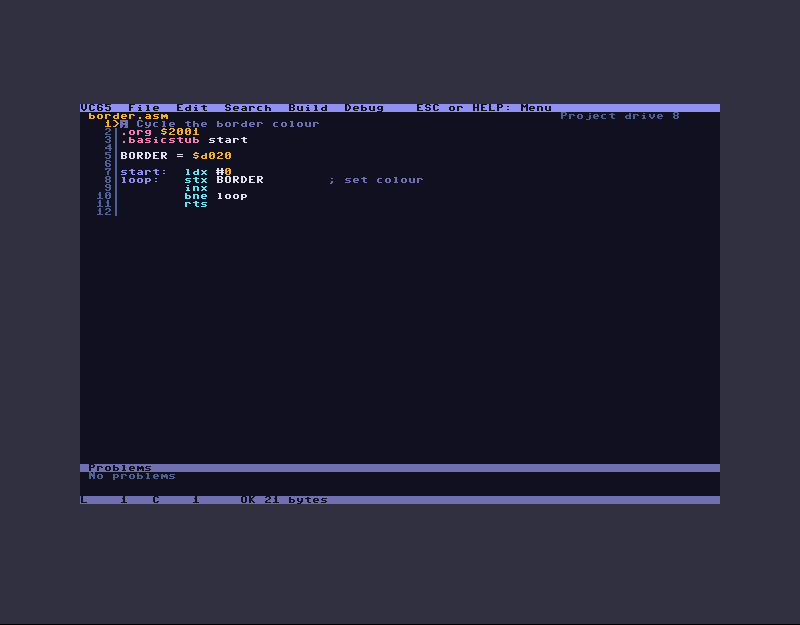
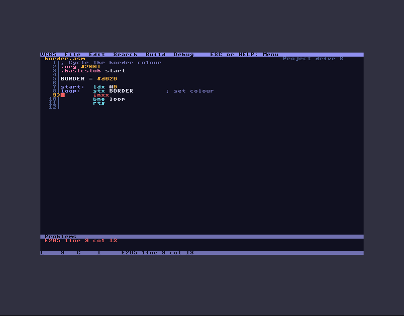

<!-- SPDX-License-Identifier: MIT-0 -->
# 4 Bauen und Starten

Englische Fassung: [../en/04-build-and-run.md](../en/04-build-and-run.md). Zurück zur [Übersicht](README.md). Vorabversion 0.1.0-Alpha.

> **Hinweis:** Bauen, Starten und die Notfalltaste sind nur im Emulator Xemu getestet, am echten Gerät ungeprüft. Das gilt besonders für die automatische Prüfung, das 50-Zeilen-Bild und die RESTORE-Taste.

| Taste | Menü | Wirkung |
|---|---|---|
| Strg+E | Build > Assemble | Quelltext übersetzen |
| Strg+F | File > Save program | übersetztes Programm als PRG-Datei speichern |
| Strg+R | Build > Run | Programm starten |
| Strg+D | Debug > Debugger | Programm im Debugger starten ([Kapitel 5](05-debugger.md)) |
| RESTORE | – | Notfalltaste: ein laufendes Programm unterbrechen |

## Übersetzen (Strg+E)

Strg+E übersetzt den Text im Editor. Die Ausgabe bleibt im Speicher; auf die Diskette kommt sie erst mit Strg+F.

- **Erfolg:** Die Statuszeile meldet zum Beispiel `OK 123 bytes`.
- **Fehler:** Die Statuszeile meldet den ersten Fehler, zum Beispiel `E204 line 12 col 5`, und der Cursor springt in die Fehlerzeile. Fehler in einer Include-Datei zeigen `in file n` statt der Spalte; dann springt der Cursor nicht.
- Die **Probleme-Leiste** unter dem Text zeigt bis zu drei Einträge des letzten Übersetzens, Fehler rot, Warnungen gelb (Kopf `Problems`); ohne Einträge steht dort `No problems`.
- Zeilen mit Fehlern werden im Text **rot** gefärbt (höchstens 16 Zeilen). Die Färbung bleibt bis zum nächsten Übersetzen.

Die Ladeadresse der Ausgabe ist das erste `.org` vor jeder Ausgabe.

## Automatische Prüfung

Wechselt der Cursor in eine andere Zeile und hat sich der Text seit dem letzten Übersetzen geändert, übersetzt die IDE selbst, **still**: ohne Meldung und ohne Cursorsprung. Probleme-Leiste, rote Zeilen und die Ausgabe sind danach aktuell.

- Nur bei Texten **unter 16 KB**. Ein Lauf dauert in Xemu rund 0,2 s (mit Systemdatei).
- Größere Texte übersetzen Sie weiter mit Strg+E.

> Nur im Emulator Xemu getestet. Die Geschwindigkeit bei jedem Zeilenwechsel am echten MEGA65 ist ungeprüft; ebenso, ob es spürbar stockt.

## Programm speichern (Strg+F)

Strg+F öffnet die Eingabezeile `File:`. Return schreibt die Ladeadresse (2 Byte) und die Ausgabe als PRG-Datei unter dem eingegebenen Namen auf das Projektlaufwerk. Meldung: `Program saved`; bei einem Fehler `Error saving`. Ohne vorheriges Übersetzen meldet die IDE `Assemble first`.

## Starten (Strg+R)

Strg+R kopiert die Ausgabe an ihre Ladeadresse in den Hauptspeicher (Bank 0) und startet sie:

- Mit `.basicstub` startet das Programm an der dort angegebenen SYS-Adresse, sonst an der Ladeadresse.
- Liegt die Ladeadresse unter `$2000`, meldet die IDE `Load address below $2000` und startet nicht.
- Ohne vorheriges Übersetzen: `Assemble first`.
- Das Programm sieht den üblichen 80 × 25-Bildschirm. Der Editor liegt in Bank 4 und bleibt unberührt.
- Kehrt das Programm mit `RTS` zurück, meldet die IDE `Program ended` und zeigt wieder das 50-Zeilen-Bild.

## Notfalltaste (RESTORE)

Ein Programm, das nicht zurückkehrt (Endlosschleife), unterbrechen Sie mit der **RESTORE-Taste**. Nach einem Start mit Strg+R meldet die IDE `Program interrupted (emergency key)`. Im Debugger erscheint `interrupted (emergency key) at $xxxx`, und Weiter, Schritt und Ende funktionieren wie nach einem Haltepunkt.

> Die RESTORE-Taste ist nur im Emulator Xemu getestet (ausgelöst über einen Zeitgeber), am echten MEGA65 ungeprüft. Der KERNAL behandelt STOP + RESTORE als Warmstart; ob der hier benutzte Weg dort ebenso läuft, ist offen. Steht der Programmzähler im ROM (zum Beispiel in `GETIN`), kann man weiter, aber nicht schrittweise gehen.

Ein Programm, das den Stapel oder die Zeropage zerstört oder einen eigenen IRQ/NMI-Betrieb hat, ist nicht abgedeckt.
