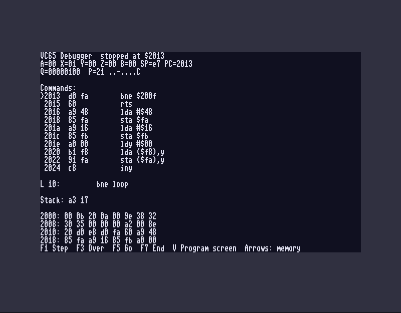

<!-- SPDX-License-Identifier: MIT-0 -->
# 5 Debugger

Englische Fassung: [../en/05-debugger.md](../en/05-debugger.md). Zurück zur [Übersicht](README.md). Vorabversion 0.1.0-Alpha.

> **Hinweis:** Der Debugger ist nur im Emulator Xemu getestet. Die Wege über `BRK` und KERNAL, die Tasten, die Bildschirmumschaltung und die Notfalltaste sind am echten Gerät ungeprüft. Die Tasten sind vorläufig.

## Voraussetzung

Der Debugger liegt in der Datei `VC65D` auf der Systemdisk (Laufwerk 8). Er wird beim ersten Start des Debuggers geladen. Fehlt die Datei, meldet die IDE `File VC65D missing`.

## Haltepunkte setzen

1. Mit **Strg+E** übersetzen.
2. Den Cursor in die gewünschte Zeile stellen und **Strg+G** drücken. Die Zeile bekommt einen Haltepunkt (Meldung `Breakpoint set`); noch einmal Strg+G entfernt ihn (`Breakpoint removed`).

Die Adresse stammt aus der Zeilentabelle des letzten Übersetzens. Hat sich der Text seitdem geändert, meldet die IDE `Assemble first`. Hat die Zeile keine Ausgabe, meldet sie `No output here`. Zu viele Haltepunkte: `Too many breakpoints`.

## Debugger starten (Strg+D)

**Strg+D** startet das Programm im Debugger; es hält am Einsprung an. Der Debugger hat einen **eigenen Bildschirm** mit 25 Zeilen; Bildschirm, Farb-RAM und Grafikspeicher des Testprogramms bleiben unberührt.

| Zeile | Inhalt |
|---|---|
| 0 | Titel und Haltestelle (`VC65 Debugger  stopped at $xxxx`, `interrupted (emergency key) at $xxxx`, `Program ended`, `Debugger ended`) |
| 1 | Register A X Y Z B SP PC |
| 2 | Q (Z Y X A) und Flags |
| 4 | Beschriftung `Commands:` |
| 5 bis 14 | Disassemblierung ab PC |
| 16 | Quelltextzeile (`L 11: …`, ohne Zeilenangabe `(no line info)`) |
| 18 | Stapel (`Stack: …`) |
| 20 bis 23 | Speicher |
| 24 | Tastenhilfe: `F1 Step  F3 Over  F5 Go  F7 End  V Program screen  Arrows: memory` |

## Bedienung im Debugger

| Taste | Wirkung |
|---|---|
| F1 oder `s` | Einzelschritt |
| F3 oder `n` | darüber: ein `JSR` läuft durch |
| F5 oder `c` | weiter bis zum nächsten Haltepunkt |
| V (oder Strg+P) | Programmbild zeigen, bis zur nächsten Taste |
| Pfeil ab / auf | Speicher um 32 Byte blättern |
| F7, `q` oder STOP | Sitzung beenden (der Programmzustand wird verworfen) |

Der Debugger ist wie die IDE **nur englisch** (Titel, `Commands:`, Tastenhilfe, Meldungen). Nach dem Ende der Sitzung zeigt die IDE wieder das 50-Zeilen-Bild.

## Notfalltaste

Läuft das Programm in einer Endlosschleife, bringt die **RESTORE-Taste** den Debugger zurück (`interrupted (emergency key) at $xxxx`). Siehe [Kapitel 4](04-bauen-und-starten.md#notfalltaste-restore).

## Grenzen

- Keine Beobachtungen und Datenhaltepunkte.
- Kein Haltepunkt im ROM-Bereich ab `$C000`. Ein `JSR` in diesen Bereich läuft durch. Steht der Programmzähler im ROM, kann man weiter, aber nicht schrittweise gehen.
- Ein Programm, das Stapel oder Zeropage zerstört, und Programme mit eigenem IRQ/NMI-Betrieb sind nicht abgedeckt.
- Haltepunkte in Makrorümpfen und in Include-Dateien sind nicht möglich; die Zeilentabelle gilt nur für die Hauptdatei. Ausgabe von Makros und Includes wird der Aufrufzeile zugeordnet.
- Ändert ein Programm Bildschirm oder Farb-RAM an Stellen, die der Debugger auch benutzt (Farb-RAM ab `$0FF8_1000`), sieht man das nach dem Anhalten nicht mehr sauber.
- Ein echtes `BRK` des Programms wird beim Weiter übersprungen.
