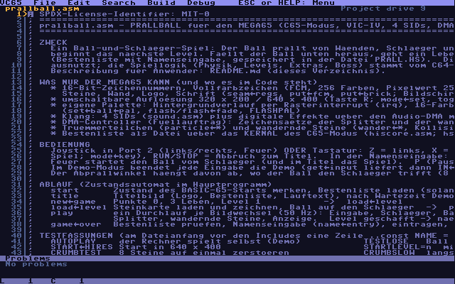

<!-- SPDX-License-Identifier: MIT-0 -->
# 6 Projekte und Dateien

Englische Fassung: [../en/06-projects-and-files.md](../en/06-projects-and-files.md). Zurück zur [Übersicht](README.md). Vorabversion 0.1.1-Alpha.

> **Hinweis:** Die Arbeit mit zwei D81 und die Umschaltung der Laufwerke mit Strg+A sind nur im Emulator Xemu getestet (Systemdisk in Laufwerk 8, Projektdisk in Laufwerk 9), am echten MEGA65 ungeprüft. Das gilt auch für das Einlegen zweier Abbilder und die Geräteumschaltung des KERNAL.

## Laufwerke

| Laufwerk | Inhalt | Wird benutzt für |
|---|---|---|
| Systemdisk, Laufwerk 8 | VC65 (`VC65`, `VC65D`, `VC65T`, `VC65X`) und die Systembibliotheken | Bibliotheken (`<mega65/…>` usw.), Overlay `VC65D` |
| Projektlaufwerk, 8 oder 9 | Ihre Quelltexte | Laden (Strg+O), Speichern (Strg+K), Programm speichern (Strg+F), `.include "datei"` |

Das Projektlaufwerk ist anfangs 8; **Strg+A** wechselt zwischen 8 und 9. Es steht rechts in der Dateizeile. Der Quelltext liegt auf einer **zweiten D81**.

## Dateinamen

- Nur Namen **ohne Ordner**, höchstens **16 Zeichen**; die Endung gehört zum Namen (`hello.asm`). Kleinbuchstaben werden für das Laufwerk zu Großbuchstaben.
- Der Editor speichert Quelltext als **PRG-Datei** (Text mit LF als Zeilenende) und ersetzt eine vorhandene Datei gleichen Namens.
- Das übersetzte Programm speichert Strg+F als PRG-Datei mit Ladeadresse.
- Ordner und lange Namen sind in dieser Version nicht möglich.

## Systemdisk

Die Systemdisk enthält die Bibliotheksdateien des MEGA65 (`<mega65/…>`, `<common/…>`, `<c64/hardware.asm>`) als Dateien `ORD.NAME` und `MEG.CHIPS` für die Chip-Symbole (14 Dateien, rund 150 KB). Die Namensregel steht in [Kapitel 1](01-einstieg.md#namen-der-systembibliotheken).

Eigene Dateien, die Sie mit `.include "datei"` einbinden, gehören auf das **Projektlaufwerk**, nicht auf die Systemdisk.

## Projekte

Diese Version arbeitet mit **einer** Datei im Editor und ohne Projektdatei. Der Quelltext kann weitere Dateien mit `.include` einbinden; sie werden bei jedem Übersetzen von der Diskette gelesen.

## Beispiele

Zur Auslieferung gehört die **Beispieldisk** `VC65-Beispiele-….d81` mit vier Programmen aus VintageCoder, fertig als Quelltext ohne Editoren und Werkzeuge: `hello.asm` (kleinstes Programm), `paldemo.asm` (256-Farben-Palette), `musicdemo.asm` (Tracker-Song auf vier SID-Chips) und `prallball.asm` (vollständiges Spiel, rund 224 KB Quelltext). Alles, was dort mit Editoren entsteht (Palette, Song, Sprites, Zeichen, Levels), steht als `.byte` in Include-Dateien auf der Disk. Disk als Laufwerk 9 einhängen, Strg+A, Strg+O und den Namen der Hauptdatei samt Endung (zum Beispiel `prallball.asm`), Strg+E, Strg+R. Beschreibung: `examples/README.md` und `examples/prallball/README.md` im Repository. In Xemu geprüft (Stand 2026-11-24): jedes Beispiel lässt sich von der Disk laden und übersetzen, das Ergebnis ist Byte für Byte gleich der Ausgabe von `vcc`, und die Programme laufen (Strg+R). Zusätzlich übersetzen auch cputest, jumprun und tiles_demo (fünf Hauptdateien) aus dem Beispielvorrat von VintageCoder. Am echten MEGA65 ist nichts davon geprüft. Medien-Dateien (`.vcsprite` usw.) wandelt VC65 nicht um.

Eigene Systemdateien, Vorlagen und Beispiele, die VC65 mitliefert, stehen unter MIT-0 und dürfen ohne Auflagen verwendet werden (siehe [LICENSING.md](../../../LICENSING.md)).
