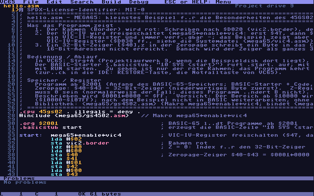
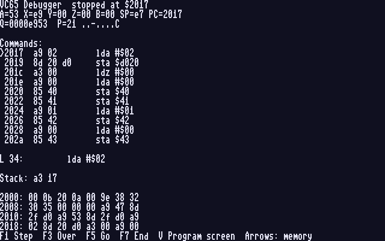

<!-- SPDX-License-Identifier: MIT-0 -->
# 8 Anleitung: Ihr erstes Programm

Englische Fassung: [../en/08-first-program.md](../en/08-first-program.md). Zurück zur [Übersicht](README.md). Vorabversion 0.1.1-Alpha.

Dieses Kapitel führt Schritt für Schritt vom Start von VC65 bis zu einem laufenden Programm, das Sie selbst eingetippt, übersetzt, gestartet und im Debugger angeschaut haben. Sie brauchen dafür nur die beiden Disketten des Pakets (Boot-D81 und Beispiel-D81) und einen MEGA65 oder den Emulator Xemu. Die Einzelheiten zu jedem Schritt stehen in den Kapiteln 1 bis 7; hier geht es um den Ablauf.

> **Hinweis:** Alles in diesem Kapitel ist nur im Emulator Xemu getestet, am echten MEGA65 ungeprüft.

## Was das Programm tun soll

Das Programm schreibt den Gruß `HELLO FROM VC65!` auf den Bildschirm und wartet auf eine Taste. Danach kehrt es zu VC65 zurück. Es besteht aus drei Teilen:

1. Einer BASIC-Startzeile (`.basicstub`), damit man es auch mit `RUN` starten kann.
2. Einer Schleife, die Zeichen für Zeichen den Text über die KERNAL-Routine `CHROUT` ausgibt.
3. Einer Warteschleife mit `GETIN`, damit der Gruß stehen bleibt, bis Sie eine Taste drücken (kehrt ein Programm sofort zurück, schaltet VC65 gleich wieder auf das 50-Zeilen-Bild um, und der Gruß wäre nicht zu sehen).

## Schritt 1: VC65 starten

1. Legen Sie die Boot-D81 (`VC65-0.1.1-alpha.d81`) als **Laufwerk 8** und die Beispiel-D81 als **Laufwerk 9** ein. Im Emulator Xemu hängen Sie beide Abbilder an die beiden Laufwerke an.
2. Tippen Sie in BASIC `DLOAD"VC65"` und danach `RUN`. VC65 kopiert sich in einen eigenen Speicherbereich (Bank 4) und zeigt das Startbild mit dem Logo.
3. Eine beliebige Taste führt in den Editor. Er zeigt 80 × 50 Zeichen; oben steht die Befehlsleiste, unten die Dateizeile, die Probleme-Leiste und die Statuszeile ([Kapitel 2](02-editor.md)).

## Schritt 2: Das Projektlaufwerk wählen

Der Quelltext liegt normalerweise auf einer zweiten Diskette. Drücken Sie **Strg+A**, bis die Statuszeile `Project drive 9` meldet. Rechts in der Dateizeile steht jetzt `9`. Das Beispiel-D81 ist damit das Projektlaufwerk; Bibliotheken wie `<mega65/kernal.asm>` liest VC65 weiter von der Systemdisk in Laufwerk 8.

Wollen Sie eigene Dateien speichern, legen Sie dafür besser eine eigene, leere D81 als Laufwerk 9 an, damit die ausgelieferte Beispieldisk unverändert bleibt.

## Schritt 3: Den Quelltext eintippen

Tippen Sie den folgenden Text in den leeren Editor. Groß- und Kleinschreibung spielt bei Befehlen keine Rolle; Einrückungen sind frei (Sie können sie später über das Menü **Edit > Align all** ausrichten lassen, siehe [Kapitel 2](02-editor.md#ausrichten)). Kommentare beginnen mit `;`.

```asm
; greet.asm - prints a greeting and waits for a key
#include <mega65/kernal.asm>

.org $2001
.basicstub start

start:  ldx #0
loop:   lda text,x          ; next character
        beq wait            ; 0 = end of text
        jsr CHROUT          ; print it (KERNAL)
        inx
        bne loop
wait:   jsr GETIN           ; poll the keyboard
        beq wait            ; no key yet: keep waiting
        rts                 ; back to VC65 ("Program ended")

text:   .textnull "HELLO FROM VC65!"
```

Alle Texte im Quelltext sind englisch; das gilt für Kommentare und Zeichenketten in VC65-Programmen (siehe [Kapitel 1](01-einstieg.md)). Die Zeichen `_` und `|` lassen sich auf manchen Tastaturen im Emulator nicht tippen; dieses Programm braucht sie nicht.

Was die Zeilen bedeuten:

| Zeile | Bedeutung |
|---|---|
| `#include <mega65/kernal.asm>` | Systemdatei mit den Namen der KERNAL-Sprungtabelle (`CHROUT`, `GETIN`, …); sie wird von der Boot-D81 gelesen |
| `.org $2001` | Das Programm beginnt bei `$2001`, dem Anfang des BASIC-65-Speichers |
| `.basicstub start` | erzeugt die BASIC-Zeile `10 SYS <Adresse von start>` |
| `start:` | eine **Marke** (Label); sie steht für die Adresse der Zeile |
| `ldx #0` | lädt den Wert 0 in das X-Register (`#` = Zahl, keine Adresse) |
| `lda text,x` | holt das Zeichen an der Adresse `text + X` |
| `beq wait` | verzweigt, wenn das Ergebnis 0 war: das Textende ist erreicht |
| `jsr CHROUT` | ruft die KERNAL-Routine auf, die das Zeichen auf dem Bildschirm ausgibt |
| `inx` / `bne loop` | nächstes Zeichen; zurück an den Schleifenanfang, solange X nicht überläuft |
| `jsr GETIN` / `beq wait` | fragt die Tastatur ab; 0 bedeutet: keine Taste gedrückt |
| `rts` | Rücksprung zu VC65 |
| `.textnull "…"` | legt den Text als Bytes ab, mit einem Nullbyte am Ende |

## Schritt 4: Übersetzen

Drücken Sie **Strg+E**. Bei Erfolg meldet die Statuszeile `OK n bytes` (n = Größe der Ausgabe; bei diesem Programm `OK 48 bytes`). Das Programm liegt jetzt im Speicher, auf der Diskette ist noch nichts.



Bei einem Tippfehler meldet die Statuszeile den ersten Fehler, zum Beispiel `E205 line 8 col 13`, und der Cursor springt in die Zeile. Die Probleme-Leiste nennt bis zu drei Einträge. Was die Codes bedeuten, steht in [Kapitel 11](11-fehlercodes.md). Probieren Sie es aus: Ändern Sie `lda` zu `lad`, drücken Sie Strg+E, und beobachten Sie die rote Zeile. Ändern Sie es zurück.

## Schritt 5: Starten

Drücken Sie **Strg+R**. VC65 kopiert das Programm an seine Adresse in den Hauptspeicher und startet es. Sie sehen den üblichen 80 × 25-Bildschirm mit dem Gruß `HELLO FROM VC65!`. Eine beliebige Taste beendet das Programm; VC65 meldet `Program ended` und zeigt wieder das 50-Zeilen-Bild.

Hängt ein Programm (Endlosschleife), hilft die **RESTORE-Taste**: VC65 meldet `Program interrupted (emergency key)` ([Kapitel 4](04-bauen-und-starten.md)).

## Schritt 6: Speichern

- **Quelltext speichern: Strg+K.** Die Eingabezeile `File:` erscheint; tippen Sie `greet.asm` und Return. Die Statuszeile meldet `Saved`. Ohne Strg+K bleibt der Quelltext nur im Speicher und geht beim Beenden verloren.
- **Programm speichern: Strg+F.** Dasselbe Verfahren mit einem Namen wie `greet` ergibt die PRG-Datei, die Sie in BASIC mit `LOAD"GREET",9` laden und mit `RUN` starten können (Meldung `Program saved`).

## Schritt 7: Im Debugger ansehen

1. Übersetzen Sie mit **Strg+E** (ohne aktuelle Ausgabe meldet VC65 `Assemble first`). Setzen Sie den Cursor in die Zeile `jsr CHROUT` und drücken Sie **Strg+G**: `Breakpoint set`. Noch einmal Strg+G entfernt den Haltepunkt wieder.
2. Drücken Sie **Strg+D**. Der Debugger startet das Programm in einem eigenen 25-Zeilen-Bild und hält zuerst am Einsprung an ([Kapitel 5](05-debugger.md)). **F5** läuft von dort bis zum Haltepunkt.



3. Danach führt **F1** (oder `s`) einen Einzelschritt aus, **F3** (oder `n`) geht über einen `JSR` hinweg, **F5** (oder `c`) läuft bis zum nächsten Haltepunkt. Beobachten Sie das X-Register: Bei jedem Durchlauf der Schleife wächst es um 1, und der Akkumulator enthält den Code des Zeichens (`$48` für `H`).
4. **V** zeigt das Bild des Programms bis zur nächsten Taste: Sie sehen die bisher ausgegebenen Buchstaben.
5. **q** (oder STOP, F7) beendet die Sitzung.

## Schritt 8: Weiter ausprobieren

- Ändern Sie den Text, und lassen Sie ihn nach jedem Zeichen auf eine Taste warten.
- Setzen Sie hinter `start:` die Zeilen `lda #2` und `sta $d020` ein: Der Rahmen wird rot (statt `$d020` geht auch der Chip-Symbolname `vic2.border`, siehe [Kapitel 3](03-assembler.md)).
- Laden Sie mit **Strg+O** eines der Beispiele von der Beispieldisk ([Kapitel 9](09-beispiele.md)) und lesen Sie die Kommentare am Dateianfang.
- Schlagen Sie Tasten und Meldungen in [Kapitel 7](07-referenz.md) nach; bei Problemen hilft [Kapitel 10](10-fehlersuche.md).
