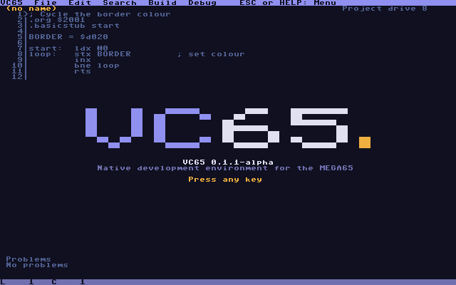

<!-- SPDX-License-Identifier: MIT-0 -->
# 1 Getting started

German version: [../de/01-einstieg.md](../de/01-einstieg.md). Back to the [overview](README.md).

This guide describes the **prerelease 0.1.1-Alpha** of VC65. It is not yet released. Much of it has so far only been tested in the Xemu emulator; the section [Status and limits](#status-and-limits) lists what is still unchecked on a real device.

## What VC65 is

VC65 is a development environment that runs **on the MEGA65 itself**. It combines in one program:

- a full-screen **editor** (80 × 50 characters),
- an **assembler** that understands VintageCoder's VCASM language,
- a **debugger** (breakpoints, single step, registers).

Writing, assembling, running and checking source code all happen on the device, without a PC. VC65 targets the **MEGA65** only. There is no C64 target.

The editor works with **one** file; there are no tabs for several files.

## Language of the program: English only

The user interface of VC65 (command bar, menus, status line messages, input lines, problems bar) and the debugger are **in English only**. The guide and the website are available in **German and English**. Error codes `E2nn`/`W2nn` and `E9xx` are unchanged.

## Requirements

- A MEGA65 with the original ROM (or Xemu for testing without the device).
- Drive 8 with the boot disk (D81, see below).
- For your own source files, a project drive: drive 8 or 9 (see [Two drives](#two-drives)).

## Files on the boot D81

The disk that carries VC65 (the system disk) contains:

| File | Contents |
|---|---|
| `VC65` | the main program (editor and assembler) |
| `VC65D` | the debugger; loaded the first time the debugger is started (Ctrl+D) |
| `VC65T` | the instruction table of the assembler; loaded at start |
| `VC65X` | tools overlay (align etc.); loaded on first use, replacing the debugger overlay (which is reloaded at the next Ctrl+D) |
| System libraries | the MEGA65 system files as files with flat names `ORD.NAME` |

If `VC65T` is missing, VC65 returns to BASIC at start. If `VC65X` is missing, the IDE reports `File VC65X missing` when a tool is needed. If `VC65D` is missing, the IDE reports `File VC65D missing` when you start the debugger.

### Names of the system libraries

A D81 has no folders and names of at most 16 characters. A library `<folder/name.ext>` is therefore called `ORD.NAME`: the first three characters of the folder, a dot, the name without extension, all in capital letters.

| In the source | Name on the disk |
|---|---|
| `<mega65/vic4.asm>` | `MEG.VIC4` |
| `<common/tiles.asm>` | `COM.TILES` |
| `<c64/hardware.asm>` | `C64.HARDWARE` |

The file `MEG.CHIPS` holds the chip symbols (for example `vic2.border`); the assembler includes it itself on every run. If it is missing, only these symbols are missing. The system disk currently holds 14 library files (about 150 KB).

## Start

VC65 is a PRG that BASIC loads and that is started with `RUN`. At start it copies itself to its own memory area (bank 4); afterwards main memory (bank 0) is free for the program under test. After the start a splash screen shows the logo and the version; any key continues to the editor. The same screen appears under **File > About VC65**. **STOP** ends VC65 and returns to BASIC.

## Two drives

| Drive | Purpose |
|---|---|
| **System disk**, drive 8 | VC65 itself, the overlay `VC65D`, the system libraries |
| **Project drive**, 8 or 9 | Your source: load, save, your own `.include` files |

The project drive starts as 8. **Ctrl+A** switches between 8 and 9 (message `Project drive 9`). The current project drive is shown at the right of the file line. Your source normally lives on a second D81 in drive 9.

## Status and limits

**Prerelease 0.1.1-Alpha.** Everything in VC65 runs in the **Xemu** emulator and passes its tests there. **Nothing of it is completely checked on a real MEGA65.** The guide marks the points that are especially open with the note "tested only in the Xemu emulator, unchecked on the real device":

- the **HELP key** (key code `$84`) and with it the **menu** and all menu entries, likewise the **ESC key** and the function keys (VC65 switches off the KERNAL function-key assignment at start),
- the **50-line screen** with header lines, problems bar and colors,
- **loading the file `VC65T`** at start,
- the **automatic check** on line change (speed),
- **two D81** (system disk and project drive) and switching with Ctrl+A,
- the **emergency key RESTORE**,
- the debugger keys and the `BRK` and KERNAL paths,
- the key codes of the other keys (all key assignments are provisional).

Further limits:

- There is only one target, `mega65`. The assembler reports any other target as error E207.
- No tabs, one source at a time.
- The assembler does not understand VCASM completely; see [chapter 3](03-assembler.md).
- The debugger has limits; see [chapter 5](05-debugger.md).
- The key assignment is provisional and may still change.

## License

What you create with VC65 belongs to you and may be used freely. VC65 itself is under GPL-3.0-or-later. Details: [LICENSING.md](../../../LICENSING.md) (German).
