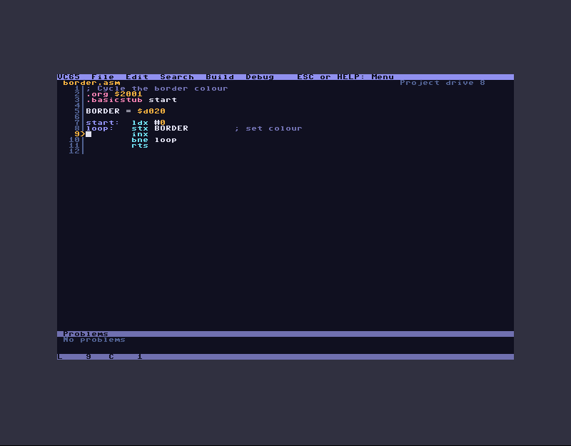
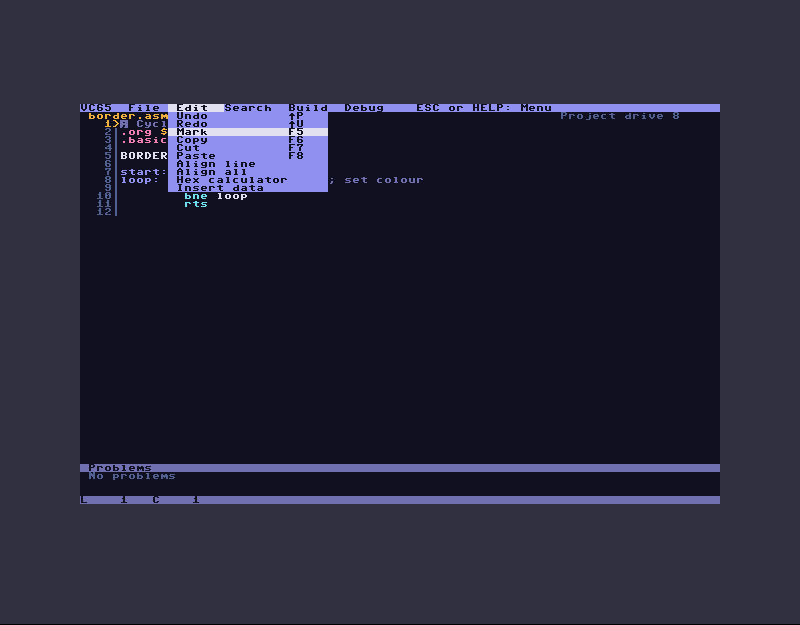

<!-- SPDX-License-Identifier: MIT-0 -->
# 2 Editor

German version: [../de/02-editor.md](../de/02-editor.md). Back to the [overview](README.md). Prerelease 0.1.0-Alpha.

> **Note:** All key codes are provisional. The editor is tested only in the Xemu emulator, unchecked on the real device. This applies especially to the HELP key (code `$84`), the menu and the 50-line screen.

## Screen

The editor shows 80 × 50 characters. From top to bottom:

| Row | Contents |
|---|---|
| 0 | **Command bar** (light blue): `VC65  File  Edit  Search  Build  Debug` and `ESC or HELP: Menu` at the right |
| 1 | **File line**: name of the file (or `(no name)`) and the project drive at the right |
| 2 onward | **Text** with five columns of line numbers and a vertical bar after them |
| 4 rows | **Problems bar**: heading `Problems` and up to three entries of the last assembly |
| last | **Status line**: messages and input lines; at the right the cursor position `L nnnn C nnnn` (L = line, C = column) |

The cursor line carries a `>` and a yellow line number. A selection is shown inverted. While you type, the text is colored: comments, text, numbers, directives, labels and instructions each have their own color.

Lines with errors are colored **red** (at most 16 lines). In the problems bar errors are red (for example `E205 line 10 col 13`) and warnings yellow (`W206 …`); without entries it says `No problems`. More in [chapter 4](04-build-and-run.md).

The editor works with **one** file of at most 768 KB of text. The line end is LF internally; the character with code 0 does not occur in the text.

## Keys

The table shows the editor keys. Commands for building, running and the debugger are in [chapter 4](04-build-and-run.md) and [5](05-debugger.md); a complete list is in the [reference](07-reference.md).

| Key | Effect |
|---|---|
| Character keys | insert a character |
| Return | new line, indented like the previous line |
| Tab | to the next multiple of 4 |
| DEL | delete the character to the left |
| Shift+DEL (`$94`) | delete the character under the cursor (forward delete) |
| Cursor keys | move |
| Home (HOME) | start of line |
| CLR (`$93`) | end of line |
| Ctrl+V (`$16`) / Ctrl+W (`$17`) | page up / page down |
| Ctrl+P (`$10`) | undo |
| Ctrl+U (`$15`) | redo |
| F1 | find |
| F2 | find next |
| F4 | find backwards |
| F3 | go to line |
| F5 | mark (start or clear a selection) |
| F6 | copy |
| F7 | cut |
| F8 | paste |
| Ctrl+O (`$0F`) | load file |
| Ctrl+K (`$0B`) | save file |
| Ctrl+A (`$01`) | project drive 8 / 9 |
| ESC / HELP (`$84`) | open the menu (ESC also closes it) |
| STOP | end VC65 |

## Selection, copy, undo

**Selection:** F5 sets the start at the cursor. The movement keys then extend the selection. Another F5 clears it.

**Clipboard:** F6 copies (and clears the selection), F7 cuts, F8 pastes; an active selection is replaced when pasting. The clipboard holds at most 64 KB. If the selection is too large or the memory is full, nothing happens. It is kept when you load another file, so text can be carried between files.

**Deleting:** DEL and Shift+DEL delete an active selection. Characters, Return, Tab, undo and redo clear the selection.

**Undo and redo:** Consecutive inputs of the same kind (characters and Tab, Return, DEL, Shift+DEL) form a group. Undo reverts the whole last group, redo replays it. Cut, paste and deleting a selection are one group each. A new change discards the redo steps. Loading a file clears the history.

## Find, replace, go to

**Find (F1):** The status line shows `Find:  …` with the last pattern to edit (at most 32 characters). Return accepts, STOP cancels. The search starts after the cursor and wraps around the end of the text; upper and lower case do not matter. On a hit the cursor stands on it; otherwise it stays where it was. **F2** finds the next hit, **F4** searches backwards.

**Replace (menu Search > Replace):** Two input lines, `Find:` and `Replace`. **All hits from the cursor to the end of the text** are replaced (no wrap-around, case ignored). The message is `n replaced`. Each replacement can be undone step by step.

**Go to (F3):** Input line `Line:  …`, at most 4 digits. 0 counts as 1; past the last line the cursor lands at the start of the last line.

**Marks 1 to 9 (menu Search):** *Set mark* asks for a digit 1 to 9 and remembers the number of the cursor line (input line `Mark:  `, message `Mark set`). *Go to mark* asks for a digit and jumps to that line; if the mark is not set: `Mark not set`. A mark is a **line number**; it does not move when lines are inserted or deleted before it.

**Find label (menu Search):** asks for a name (input line `Label: `) and jumps to the line that begins with this name followed by a colon, white space or the end of the line. Case does not matter. If nothing is found: `Label not found`. The search overwrites the F1 search pattern.

## Hex calculator and insert data

Both are in the Edit menu and use an input line (Return accepts, STOP cancels); they are loaded from the file `VC65X` on first use.

- **Hex calculator:** input line `Calc:  `, input such as `2000+3f` or `$d020-$d000` (16 bit, hexadecimal, `$` may be omitted). The status line shows `$203f = 8255` (hexadecimal and decimal). An invalid input shows `Input?`.
- **Insert data:** input line `Range: `, input `from to` in hexadecimal, for example `2000 20ff`. The memory range of the test program (bank 0) is inserted as lines `        .byte $xx,$xx,…` (8 values per line) **before** the cursor line; at most 256 bytes, otherwise `Range too large (256)`.

## Align

Menu Edit > *Align line* (current line) or *Align all* (whole text) puts labels, instructions, operands and comments into fixed columns:

| Part | Column |
|---|---|
| Label | 0 |
| Instruction | 8 |
| Operand | 8 + the larger of 4 and (length of the instruction + 1) |
| Comment | 32, or one space after the operand if there is no room |

Comment lines, lines with `.` or `#` in column 0 and constants with `=` stay unchanged. White space at the end of a line is removed. Lines of 100 characters or more stay untouched. Quotation marks keep a `;` in the operand from being read as a comment.

## Menu (ESC or HELP)

The **ESC** or **HELP** key opens a menu with drop-down fields. **Left/right** changes the field, **up/down** selects an entry, **Return** runs it, **STOP, ESC or HELP** closes the menu. An entry acts like the matching key. The fields show the shortcuts. The full table is in the [reference](07-reference.md#menu).

> The menu is tested only in the Xemu emulator. The function keys and HELP work because VC65 switches off the KERNAL function-key assignment at start; this is tested only in Xemu, unchecked on the real device (as is whether HELP delivers code `$84` there).

## Load and save

**Load (Ctrl+O)** and **save (Ctrl+K)** open the input line `File:  …` with the last used name. Return runs it, STOP cancels.

- Only file names without folders, at most 16 characters; on load the extension is part of the name (for example `hello.asm`); lower-case letters become capitals for the drive.
- The files are on the **project drive** (8 or 9, see [chapter 6](06-projects-and-files.md)).
- On load the text replaces the previous one. Line ends CR, CRLF and LF become LF; null bytes are dropped. If the file is missing, the text stays unchanged. An **empty file** cannot be loaded (the drive reports it as a read error). If the file is too large, only its beginning is loaded.
- Saving creates a PRG file with the unchanged text; an existing file of the same name is replaced.
- Messages in the status line from column 20 until the next key: `Saved`, `Error loading`, `Error saving`.

The file is written to disk only with Ctrl+K.
