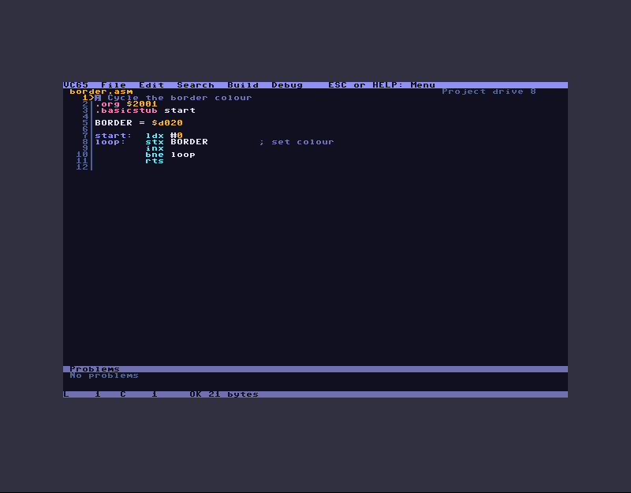
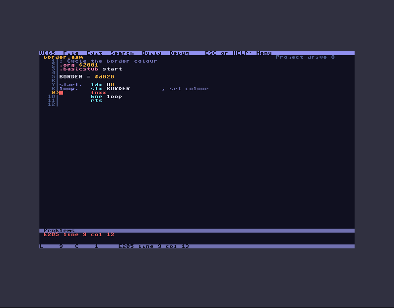

<!-- SPDX-License-Identifier: MIT-0 -->
# 4 Build and run

German version: [../de/04-bauen-und-starten.md](../de/04-bauen-und-starten.md). Back to the [overview](README.md). Prerelease 0.1.0-Alpha.

> **Note:** Building, running and the emergency key are tested only in the Xemu emulator, unchecked on the real device. This applies especially to the automatic check, the 50-line screen and the RESTORE key.

| Key | Menu | Effect |
|---|---|---|
| Ctrl+E | Build > Assemble | assemble the source |
| Ctrl+F | File > Save program | save the assembled program as a PRG file |
| Ctrl+R | Build > Run | run the program |
| Ctrl+D | Debug > Debugger | run the program in the debugger ([chapter 5](05-debugger.md)) |
| RESTORE | – | emergency key: interrupt a running program |

## Assemble (Ctrl+E)

Ctrl+E assembles the text in the editor. The output stays in memory; it reaches the disk only with Ctrl+F.

- **Success:** the status line reports, for example, `OK 123 bytes`.
- **Error:** the status line reports the first error, for example `E204 line 12 col 5`, and the cursor jumps to the error line. Errors in an include file show `in file n` instead of the column; the cursor then does not jump.
- The **problems bar** below the text shows up to three entries of the last assembly, errors red and warnings yellow (heading `Problems`); without entries it says `No problems`.
- Lines with errors are colored **red** in the text (at most 16 lines). The coloring stays until the next assembly.

The load address of the output is the first `.org` before any output.

## Automatic check

When the cursor moves to another line and the text has changed since the last assembly, the IDE assembles by itself, **silently**: no message and no cursor jump. The problems bar, the red lines and the output are then up to date.

- Only for texts **under 16 KB**. One run takes about 0.2 s in Xemu (with the system file).
- Larger texts you still assemble with Ctrl+E.

> Tested only in the Xemu emulator. The speed at every line change on a real MEGA65 is unchecked, and so is whether it stutters noticeably.

## Save program (Ctrl+F)

Ctrl+F opens the input line `File:`. Return writes the load address (2 bytes) and the output as a PRG file under the entered name to the project drive. Message: `Program saved`; on error `Error saving`. Without a previous assembly the IDE reports `Assemble first`.

## Run (Ctrl+R)

Ctrl+R copies the output to its load address in main memory (bank 0) and starts it:

- With `.basicstub` the program starts at the SYS address given there, otherwise at the load address.
- If the load address is below `$2000`, the IDE reports `Load address below $2000` and does not start.
- Without a previous assembly: `Assemble first`.
- The program sees the usual 80 × 25 screen. The editor lives in bank 4 and stays untouched.
- If the program returns with `RTS`, the IDE reports `Program ended` and shows the 50-line screen again.

## Emergency key (RESTORE)

A program that does not return (endless loop) is interrupted with the **RESTORE key**. After a start with Ctrl+R the IDE reports `Program interrupted (emergency key)`. In the debugger `interrupted (emergency key) at $xxxx` appears, and continue, step and end work as after a breakpoint.

> The RESTORE key is tested only in the Xemu emulator (triggered by a timer), unchecked on a real MEGA65. The KERNAL treats STOP + RESTORE as a warm start; whether the path used here works the same way there is open. If the program counter is in the ROM (for example in `GETIN`), you can continue but not single-step.

A program that destroys the stack or the zero page, or that uses its own IRQ/NMI handling, is not covered.
