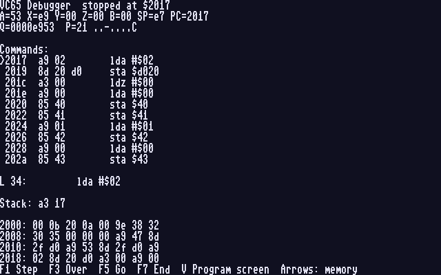

<!-- SPDX-License-Identifier: MIT-0 -->
# 5 Debugger

German version: [../de/05-debugger.md](../de/05-debugger.md). Back to the [overview](README.md). Prerelease 0.1.1-Alpha.

> **Note:** The debugger is tested only in the Xemu emulator. The `BRK` and KERNAL paths, the keys, the screen switching and the emergency key are unchecked on the real device. The keys are provisional.

## Requirement

The debugger is in the file `VC65D` on the system disk (drive 8). It is loaded the first time the debugger is started. If the file is missing, the IDE reports `File VC65D missing`.

## Setting breakpoints

1. Assemble with **Ctrl+E**.
2. Put the cursor on the wanted line and press **Ctrl+G**. The line gets a breakpoint (message `Breakpoint set`); another Ctrl+G removes it (`Breakpoint removed`).

The address comes from the line table of the last assembly. If the text has changed since, the IDE reports `Assemble first`. If the line has no output, it reports `No output here`. Too many breakpoints: `Too many breakpoints`.

## Starting the debugger (Ctrl+D)

**Ctrl+D** runs the program in the debugger; it stops at the entry point. The debugger has its **own screen** of 25 lines; screen, color RAM and graphics memory of the program under test stay untouched.

| Row | Contents |
|---|---|
| 0 | title and stop location (`VC65 Debugger  stopped at $xxxx`, `interrupted (emergency key) at $xxxx`, `Program ended`, `Debugger ended`) |
| 1 | registers A X Y Z B SP PC |
| 2 | Q (Z Y X A) and flags |
| 4 | label `Commands:` |
| 5 to 14 | disassembly from PC |
| 16 | source line (`L 11: …`, without line information `(no line info)`) |
| 18 | stack (`Stack: …`) |
| 20 to 23 | memory |
| 24 | key help: `F1 Step  F3 Over  F5 Go  F7 End  V Program screen  Arrows: memory` |

## Operation in the debugger

| Key | Effect |
|---|---|
| F1 or `s` | single step |
| F3 or `n` | step over: a `JSR` runs through |
| F5 or `c` | continue to the next breakpoint |
| V (or Ctrl+P) | show the program screen until the next key |
| Arrow down / up | scroll memory by 32 bytes |
| F7, `q` or STOP | end the session (the program state is discarded) |

Like the IDE, the debugger is **in English only** (title, `Commands:`, key help, messages). After the session ends the IDE shows the 50-line screen again.

## Emergency key

If the program runs in an endless loop, the **RESTORE key** brings the debugger back (`interrupted (emergency key) at $xxxx`). See [chapter 4](04-build-and-run.md#emergency-key-restore).

## Limits

- No watches and no data breakpoints.
- No breakpoint in the ROM area from `$C000`. A `JSR` into this area runs through. If the program counter is in the ROM, you can continue but not single-step.
- A program that destroys the stack or the zero page, and programs with their own IRQ/NMI handling, are not covered.
- Breakpoints in macro bodies and include files are not possible; the line table covers only the main file. Output of macros and includes is assigned to the calling line.
- If a program changes screen or color RAM in places the debugger also uses (color RAM from `$0FF8_1000`), you no longer see this cleanly after the stop.
- A real `BRK` of the program is skipped on continue.
