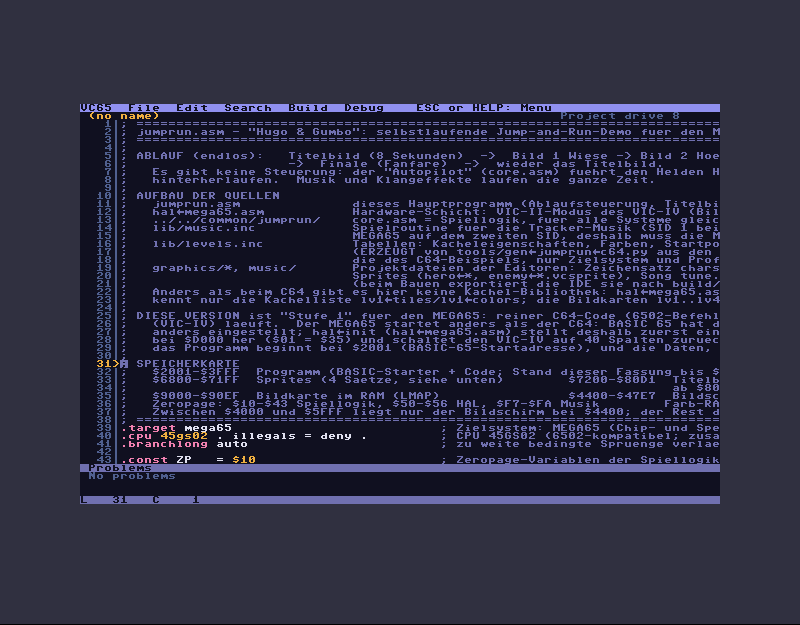

<!-- SPDX-License-Identifier: MIT-0 -->
# 6 Projects and files

German version: [../de/06-projekte-und-dateien.md](../de/06-projekte-und-dateien.md). Back to the [overview](README.md). Prerelease 0.1.0-Alpha.

> **Note:** Working with two D81 and switching the drives with Ctrl+A are tested only in the Xemu emulator (system disk in drive 8, project disk in drive 9), unchecked on a real MEGA65. This also applies to inserting two images and the KERNAL's device switching.

## Drives

| Drive | Contents | Used for |
|---|---|---|
| System disk, drive 8 | VC65 (`VC65`, `VC65D`, `VC65T`, `VC65X`) and the system libraries | libraries (`<mega65/…>` etc.), overlay `VC65D` |
| Project drive, 8 or 9 | Your sources | load (Ctrl+O), save (Ctrl+K), save program (Ctrl+F), `.include "file"` |

The project drive starts as 8; **Ctrl+A** switches between 8 and 9. It is shown at the right of the file line. The source lives on a **second D81**.

## File names

- Only names **without folders**, at most **16 characters**; the extension is part of the name (`hello.asm`). Lower-case letters become capitals for the drive.
- The editor saves source as a **PRG file** (text with LF as line end) and replaces an existing file of the same name.
- The assembled program is saved by Ctrl+F as a PRG file with its load address.
- Folders and long names are not possible in this version.

## System disk

The system disk holds the MEGA65 library files (`<mega65/…>`, `<common/…>`, `<c64/hardware.asm>`) as files `ORD.NAME` and `MEG.CHIPS` for the chip symbols (14 files, about 150 KB). The naming rule is in [chapter 1](01-getting-started.md#names-of-the-system-libraries).

Your own files that you include with `.include "file"` belong on the **project drive**, not on the system disk.

## Projects

This version works with **one** file in the editor and without a project file. The source can include further files with `.include`; they are read from disk on every assembly.

## Examples

The release includes the **examples disk** `VC65-Beispiele-….d81` with four programs from VintageCoder, ready as source without editors and tools: `hello.asm` (smallest program), `paldemo.asm` (256-colour palette), `musicdemo.asm` (tracker song on four SID chips) and `prallball.asm` (complete game, about 224 KB of source). Everything that is made with editors there (palette, song, sprites, characters, levels) is on the disk as `.byte` in include files. Mount the disk as drive 9, Ctrl+A, Ctrl+O and the name of the main file including its extension (for example `prallball.asm`), Ctrl+E, Ctrl+R. Description: `examples/README.md` and `examples/prallball/README.md` in the repository. Checked in Xemu (as of 2026-11-24): every example can be loaded from the disk and assembled, the result is byte for byte equal to the output of `vcc`, and the programs run (Ctrl+R). In addition cputest, jumprun and tiles_demo (five main files) from the example collection of VintageCoder assemble too. Nothing of this is checked on a real MEGA65. VC65 does not convert media files (`.vcsprite` etc.).

System files, templates and examples that VC65 ships are under MIT-0 and may be used without conditions (see [LICENSING.md](../../../LICENSING.md), German).
