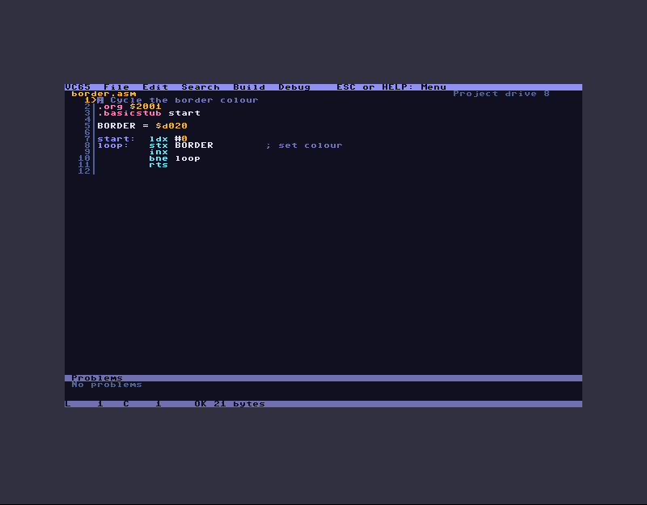
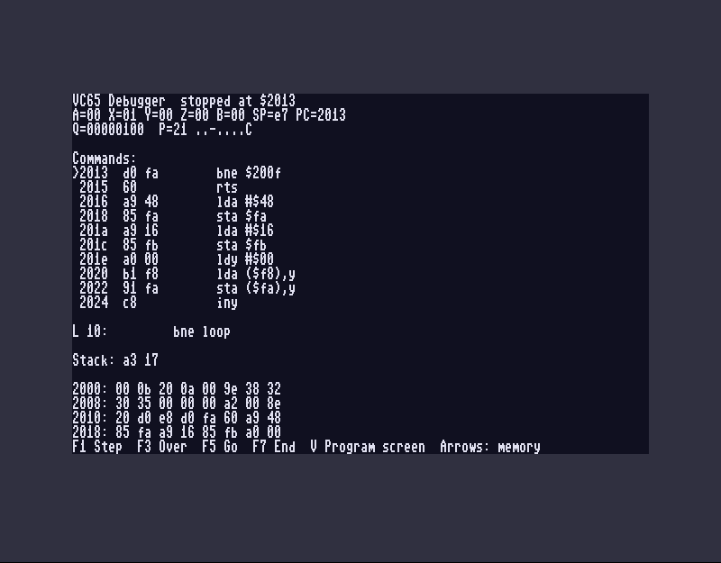

<!-- SPDX-License-Identifier: MIT-0 -->
# 8 Tutorial: your first program

German version: [../de/08-erstes-programm.md](../de/08-erstes-programm.md). Back to the [overview](README.md). Prerelease 0.1.0-Alpha.

This chapter leads step by step from starting VC65 to a running program that you typed, assembled, started and looked at in the debugger yourself. You only need the two disks of the package (boot D81 and examples D81) and a MEGA65 or the Xemu emulator. The details of each step are in chapters 1 to 7; this chapter is about the workflow.

> **Note:** Everything in this chapter is tested only in the Xemu emulator, unchecked on a real MEGA65.

## What the program should do

The program writes the greeting `HELLO FROM VC65!` on the screen and waits for a key. Then it returns to VC65. It has three parts:

1. A BASIC start line (`.basicstub`), so that you can also start it with `RUN`.
2. A loop that prints the text character by character with the KERNAL routine `CHROUT`.
3. A wait loop with `GETIN`, so that the greeting stays until you press a key (if a program returns at once, VC65 switches back to the 50-line screen immediately and the greeting would not be visible).

## Step 1: start VC65

1. Insert the boot D81 (`VC65-0.1.0-alpha.d81`) as **drive 8** and the examples D81 as **drive 9**. In the Xemu emulator, attach both images to the two drives.
2. In BASIC, type `DLOAD"VC65"` and then `RUN`. VC65 copies itself into its own memory area (bank 4) and shows the start screen with the logo.
3. Any key leads to the editor. It shows 80 × 50 characters; at the top is the command bar, at the bottom the file line, the problems bar and the status line ([chapter 2](02-editor.md)).

## Step 2: choose the project drive

The source text normally lives on a second disk. Press **Ctrl+A** until the status line reports `Project drive 9`. The file line now shows `9` on the right. The examples D81 is now the project drive; libraries such as `<mega65/kernal.asm>` are still read by VC65 from the system disk in drive 8.

If you want to save files of your own, it is better to create a separate, empty D81 as drive 9, so that the supplied examples disk stays unchanged.

## Step 3: type the source text

Type the following text into the empty editor. Upper and lower case do not matter for instructions; indentation is free (you can have it aligned later with the menu **Edit > Align all**, see [chapter 2](02-editor.md#align)). Comments start with `;`.

```asm
; greet.asm - prints a greeting and waits for a key
.cpu 45gs02
#include <mega65/kernal.asm>

.org $2001
.basicstub start

start:  ldx #0
loop:   lda text,x          ; next character
        beq wait            ; 0 = end of text
        jsr CHROUT          ; print it (KERNAL)
        inx
        bne loop
wait:   jsr GETIN           ; poll the keyboard
        beq wait            ; no key yet: keep waiting
        rts                 ; back to VC65 ("Program ended")

text:   .textnull "HELLO FROM VC65!"
```

All text in the source is English; this applies to comments and strings in VC65 programs (see [chapter 1](01-getting-started.md)). The characters `_` and `|` cannot be typed on some keyboards in the emulator; this program does not need them.

What the lines mean:

| Line | Meaning |
|---|---|
| `.cpu 45gs02` | instruction set of the MEGA65 (VC65 knows only this target) |
| `#include <mega65/kernal.asm>` | system file with the names of the KERNAL jump table (`CHROUT`, `GETIN`, …); it is read from the boot D81 |
| `.org $2001` | the program starts at `$2001`, the beginning of BASIC 65 memory |
| `.basicstub start` | creates the BASIC line `10 SYS <address of start>` |
| `start:` | a **label**; it stands for the address of the line |
| `ldx #0` | loads the value 0 into the X register (`#` = number, not an address) |
| `lda text,x` | fetches the character at the address `text + X` |
| `beq wait` | branches if the result was 0: the end of the text is reached |
| `jsr CHROUT` | calls the KERNAL routine that prints the character on the screen |
| `inx` / `bne loop` | next character; back to the start of the loop as long as X does not overflow |
| `jsr GETIN` / `beq wait` | polls the keyboard; 0 means: no key pressed |
| `rts` | return to VC65 |
| `.textnull "…"` | stores the text as bytes, with a null byte at the end |

## Step 4: assemble

Press **Ctrl+E**. On success the status line reports `OK n bytes` (n = size of the output; for this program `OK 48 bytes`). The program is now in memory; nothing is on the disk yet.



If you made a typing mistake, the status line reports the first error, for example `E205 line 9 col 13`, and the cursor jumps to the line. The problems bar lists up to three entries. What the codes mean is in [chapter 11](11-error-codes.md). Try it: change `lda` to `lad`, press Ctrl+E, and watch the red line. Change it back.

## Step 5: run

Press **Ctrl+R**. VC65 copies the program to its address in main memory and starts it. You see the usual 80 × 25 screen with the greeting `HELLO FROM VC65!`. Any key ends the program; VC65 reports `Program ended` and shows the 50-line screen again.

If a program hangs (endless loop), the **RESTORE key** helps: VC65 reports `Program interrupted (emergency key)` ([chapter 4](04-build-and-run.md)).

## Step 6: save

- **Save the source text: Ctrl+K.** The input line `File:` appears; type `greet.asm` and Return. The status line reports `Saved`. Without Ctrl+K the source text stays only in memory and is lost when you quit.
- **Save the program: Ctrl+F.** The same procedure with a name such as `greet` gives the PRG file, which you can load in BASIC with `LOAD"GREET",9` and start with `RUN` (message `Program saved`).

## Step 7: look at it in the debugger

1. Assemble with **Ctrl+E** (without current output VC65 reports `Assemble first`). Put the cursor on the line `jsr CHROUT` and press **Ctrl+G**: `Breakpoint set`. Pressing Ctrl+G again removes the breakpoint.
2. Press **Ctrl+D**. The debugger starts the program on its own 25-line screen and first stops at the entry point ([chapter 5](05-debugger.md)). **F5** runs from there to the breakpoint.



3. After that, **F1** (or `s`) executes a single step, **F3** (or `n`) steps over a `JSR`, **F5** (or `c`) runs to the next breakpoint. Watch the X register: with each pass of the loop it grows by 1, and the accumulator holds the code of the character (`$48` for `H`).
4. **V** shows the program's screen until the next key: you see the letters printed so far.
5. **q** (or STOP, F7) ends the session.

## Step 8: keep experimenting

- Change the text, and make it wait for a key after every character.
- After `start:`, insert the lines `lda #2` and `sta $d020`: the border turns red (instead of `$d020` you can also use the chip symbol name `vic2.border`, see [chapter 3](03-assembler.md)).
- Load one of the examples from the examples disk with **Ctrl+O** ([chapter 9](09-examples.md)) and read the comments at the beginning of the file.
- Look up keys and messages in [chapter 7](07-reference.md); in case of problems, [chapter 10](10-troubleshooting.md) helps.
